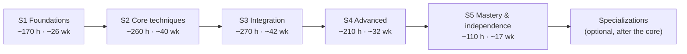

# Phase 1 — Educational vision and curriculum architecture

Status: **reviewed** (2026-11-04). The reviewer's answers to the open questions are applied (see §13.2). Conventions (dimensions K/S/J/M, levels 1–5, IDs) are in [`README.md`](README.md);
sources `[S#]` are in [`sources.md`](sources.md).

This document is the blueprint for every later phase:
- the program's philosophy;
- what a graduate can do;
- how learning progresses;
- the stages and courses, with hours;
- the top level of the competency framework;
- how learning is assessed.

It does **not** contain modules, lessons, recipes or lesson content. Those come in Phases 2 and 5–6.

---

## 1. Scope and assumptions

| # | Assumption | Consequence | Change it if… |
|---|---|---|---|
| A1 | An adult learner with little to moderate cooking experience who can follow a simple recipe and owns basic cookware. | Stage S1 starts from first principles; a diagnostic (`ORI-1`) lets experienced learners test out of parts of S1. | The learner is a complete beginner (add a bridging week), or already cooks well (allow a fast track through S1–S2 on demonstrated competence). |
| A2 | 5–8 h/week, planned at **6.5 h/week** over **46 active weeks a year** (holidays, illness, busy weeks). | About 300 h a year. | |
| A3 | About **70 % of practical work is cooked as real household meals**, so practice largely replaces cooking that would happen anyway. | Exercises are designed to give edible, sized-for-the-household results. Pure drills, such as knife practice, use ingredients that then go into a meal. | The household is a single person (more batch cooking and freezing), or larger (more scaling). |
| A4 | **Netherlands / EU baseline**: metric units, Dutch supermarkets plus specialty shops (*toko*, Turkish/Moroccan grocer, fishmonger, butcher, market), Dutch and EU food safety guidance [S21][S22][S23][S26]. US references [S24][S25] are added where they are more detailed. | Ingredient lists, seasons and safety rules follow NL/EU first. | The learner lives elsewhere (swap the authority set and ingredient notes). |
| A5 | A normal domestic kitchen: 2–4 burners (gas, ceramic or induction), one oven (often fan-assisted), a fridge-freezer, limited counter space. **Equipment is bought in tiers** (§9.4), only when a course needs it. | Each course states its minimum kit and a domestic alternative; professional equipment is optional and its effect on the result is explained. | |
| A6 | The learner has **no dietary limits** (confirmed, §13.2 Q2): eats meat, fish, dairy, eggs and gluten, and cooks with alcohol. | Meat, fish and beverage modules are core. | A future learner is vegetarian, has allergies, or avoids alcohol: the affected modules get equivalent alternatives, and the competency targets stay the same. |
| A7 | No live teacher. Feedback comes from four sources (confirmed, §13.2 Q4): the learner (structured self-assessment), objective evidence (scales, thermometers, photos), **household tasters**, and **AI review of photos and video**. | Assessment is designed around what can be verified at home (§10). Household tasters and AI review are standard evidence sources, not optional extras. | A human coach becomes available (add expert review to milestones). |
| A9 | **No fixed budget**, but every equipment and ingredient recommendation comes in two categories (§13.2 Q5): **Good** (*Goed*: a sound choice that does the job well at a sensible price) and **Best** (*Beste*: the choice a professional would make, where it makes a real difference). | Courses list both; the learner chooses. Where Best makes no real difference to the result, only Good is given, and the document says so. | |
| A8 | The program does **not** give a qualification and does **not** prepare for a professional kitchen job. Professional-only content is reduced or optional (§3). | | |

---

## 2. Educational philosophy

### 2.1 Learning to cook, not learning recipes
Professional culinary schools organise learning around **techniques and principles**, practised through a sequence of
dishes. The CIA's first course is *Culinary Fundamentals*, followed by courses on fabrication, cuisines and
production [S1]. Le Cordon Bleu moves from Basic to Superior through the same techniques at rising complexity [S3][S4].
This program follows the same model:

- **Competencies are the unit of progress**, not recipes. A recipe is a *vehicle*: it is chosen because it exercises
  specific competencies, and an equivalent recipe could replace it without changing the course.
- Progress is counted in **demonstrated competencies**, never in "dishes completed".
- From S3 on, the share of exercises that come **without a full recipe** grows steadily (§6.6). In the capstone there is
  no recipe at all.

### 2.2 Four dimensions, always made explicit
Every objective and assessment says which dimension it trains (K/S/J/M; see [README](README.md#conventions)). Two
reasons:
- **Judgment is taught and assessed on purpose.** It is the dimension self-taught cooks most often lack: they can copy a
  recipe but cannot decide what to do when the pan, the ingredient or the timing differs.
- **Mastery is a separate claim.** It is evidence of *consistent* results *under varied conditions*, never a single
  success (§10.3).

### 2.3 The teaching pattern: what → how → why → transfer
Every technique is taught through the same nine questions. This makes lessons predictable, makes gaps visible, and builds
the habit of reasoning that independent cooking needs.

| # | Question | Dimension |
|---|---|---|
| 1 | **What** is it, and what is it for? | K |
| 2 | **How** is it done (sequence, cues, equipment)? | S |
| 3 | **Why** does it work? | K |
| 4 | **What happens** to the ingredients physically and chemically? | K |
| 5 | Which **variables** change the result (heat, time, size, moisture, fat, salt, acid, equipment)? | K → J |
| 6 | Which **mistakes** are common? | K |
| 7 | How do you **recognise** them (sight, sound, smell, touch, taste, temperature)? | J |
| 8 | How do you **correct** or recover them? | J |
| 9 | Where else does this **transfer** (other ingredients, other dishes, other cuisines)? | J → M |

### 2.4 Science where it explains something
Food science [S16][S17][S18] is taught *when it explains a decision the learner must make*, not as a separate academic
subject. It runs as a thread (§6.5): heat transfer comes in with the first pan, protein coagulation with eggs, and
gelatinisation with the first sauce thickened with starch. There is one dedicated science course, `SCI-2`, which
consolidates and extends the thread into experiments the learner runs at home.

### 2.5 A spiral curriculum
Core subjects come back several times, each time at a higher level (Bruner's spiral curriculum [S29]):
- knife skills: `KNF-1` → `KNF-2` → `BUT-3`;
- sauces: `SAU-2` → `CLS-4`;
- flavour: `TST-1` → `FLV-3` → `RDV-4`;
- vegetables: `VEG-1` → `VEG-3`;
- pastry and bread: `BAK-2` → `PST-3` → `PST-4`, and `BRD-2` → `BRD-3`.

A later course always **re-assesses** earlier competencies under harder conditions instead of assuming they were
retained.

### 2.6 Deliberate practice and mastery gating
- Skills grow through **deliberate practice**: focused repetition with a specific goal, immediate feedback, and a little
  more difficulty each time [S30].
- Exercises therefore come in **series**: the same technique, varied by ingredient, quantity, equipment or constraint.
- Progression is **mastery-based** [S28]. A stage is complete when its milestone assessment and the stage's target
  competency levels (§5.3) are demonstrated, not when its lessons have been opened.

### 2.7 Senses first, instruments as calibration
- A professional cook judges mostly by sight, sound, smell, touch and taste.
- Instruments (a scale, an instant-read thermometer, a timer) are used heavily early on to **calibrate the senses**.
  Example: "this is what 57 °C feels like when pressed, and this is what it looks like when cut".
- The program then gradually moves to judging by the senses, with instruments kept for food safety and precision
  baking.
- Sensory training is a running thread from day one (§6.5).

### 2.8 Safety, economy and sustainability as constraints
- **Food safety** is taught before cooking and is never optional (§6.5).
- Practice is designed to minimise **waste and cost**: shared ingredients across a week's exercises, practice in
  household quantities, and using trim (stocks, crumbs, pickles).
- Seasonal and local produce is the default ingredient choice. This is also a lesson in judgment: knowing what is good
  *now*.

### 2.9 Reflection as a professional habit
The learner keeps a **kitchen journal** (*keukenlogboek*) from day one:
- a plan before cooking;
- notes during cooking;
- a structured evaluation and photos after.

Reflection is how a learner without a teacher turns experience into judgment. It is also the main evidence base for
assessment (§10).

---

## 3. Benchmark analysis

### 3.1 What the benchmarks look like

| Benchmark | Format | Structure and emphasis | Lesson for this program |
|---|---|---|---|
| **CIA Culinary Arts AOS** [S1] | 64 credits; four 15-week semesters plus an externship of at least 14 weeks / 550 h; 22 months full time. | *Culinary Fundamentals* (6 cr.); meat and seafood identification and fabrication; garde manger; baking and pastry skill development; cuisines and cultures of the Americas, the Mediterranean and Asia; à la carte, banquet and high-volume cooking; back- and front-of-house restaurant operations; food safety, nutrition, gastronomy, kitchen math, menus and profitability, wine and beverage. | The broadest benchmark. Fundamentals first; product knowledge and fabrication as separate subjects; cuisines taught as *cultures*, not recipe sets; math, safety and nutrition as support courses. About a third of the hours are professional production and service, which are not relevant at home (§3.2). |
| **Le Cordon Bleu Diplôme de Cuisine** [S3][S4] | Basic → Intermediate → Superior, about 180 h each (about 540 h in total). | Classical French technique, rising in complexity; regional French cuisine at the intermediate level; plating and creative work at the superior level. | The clearest model of *progressive levels*, the classical repertoire as the backbone of technique, and a final level that adds creativity. |
| **Leiths Diploma in Food and Wine** [S5] | Three terms (Foundation → Intermediate → Advanced), full time. | Breadth across modern British and international cooking, plus wine. | The term structure maps onto stages. The two-term variant shows that competence demonstrated beforehand can replace a stage. |
| **Ballymaloe 12-week Certificate** [S6] | 12 weeks, intensive. | Demonstrate → cook the next day under a teacher; producers, gardens, curing and smoking, fermentation, cheese; final practical and written exams. | Ingredient-led and seasonal; "watch, then do" maps well onto video plus a practical exercise; preservation and producer knowledge are core, not extras. |
| **MBO *Kwalificatiedossier Keuken*** (NL) [S7] | Vocational qualifications: Kok → Zelfstandig werkend kok (level 3) → Gespecialiseerd kok / Leidinggevende keuken (level 4). | Work processes: receiving and storing goods, mise en place, preparing dishes, hygiene (HACCP), and at higher levels planning and supervising. | The Dutch professional ladder is defined by **independence and responsibility**, not only by technique. This supports an explicit "level of independence" for each competency (§5.2). The work processes are compared in detail in Phase 3. |
| **Textbooks** [S8][S9][S10][S11][S12][S13] | | *The Professional Chef* and Gisslen's books cover the whole professional syllabus; Escoffier, Peterson and Hamelman go deep on classical cooking, sauces and bread. | Checklists for breadth (Phase 3 compares at chapter level). |
| **Principle-led home teaching** [S14][S15][S17][S18] | | Ratios, the elements of seasoning, and experimental home testing. | Proof that principle-first teaching works for home cooks; models for the RD and FL domains. |

### 3.2 Treatment of professional subjects at home

Key:
- **Core**: full depth.
- **Adapted**: full depth, but domestic equipment, quantities or context.
- **Reduced**: the principles only.
- **Specialization**: after the core program.
- **Omitted**: not part of the program.

| Professional subject | Benchmark | Home relevance | Treatment | Reason |
|---|---|---|---|---|
| Culinary fundamentals (methods, mise en place, knife, stocks, sauces) | CIA CULS-100 [S1]; LCB Basic [S3] | Essential | **Core** | The foundation of everything else. |
| Food safety and sanitation | CIA CUSC-100, ServSafe [S1]; MBO HACCP [S7] | Essential, with a different risk profile (household, no holding, vulnerable family members) | **Adapted** | Professional rules (holding, logs) are cut down; cooling, cross-contamination, allergens and high-risk processes stay at full depth. |
| Meat identification and fabrication | CIA CULS-115 [S1] | High, but no carcass work | **Adapted** | Whole birds, primal-to-portion trimming of supermarket and butcher cuts, and yield. Carcass breakdown is a specialization. |
| Seafood identification and fabrication | CIA CULS-116 [S1] | High | **Adapted** | Whole round and flat fish, mussels, shrimp. Advanced shellfish comes in S4. |
| Garde manger | CIA CULP-225 [S1] | Medium–high (salads, dressings, cold starters, cured fish) | **Adapted** | Charcuterie in depth is a specialization. |
| Baking and pastry | CIA BAKE-241 [S1]; [S9] | High | **Core** across `BAK-2`, `PST-3`, `PST-4` | Every serious cook needs it; advanced pastry is a specialization. |
| Bread | [S13] | High | **Core** in `BRD-2` and `BRD-3` | Bread craft beyond sourdough basics is a specialization. |
| Cuisines and cultures | CIA CULP-301/311/321 [S1] | High | **Core** in `CUI-3` and `CUI-4` | Teaches transfer: each cuisine is a logic of pantry, technique and balance. |
| Classical French | LCB [S3]; Escoffier [S11] | Medium–high (the shared vocabulary of technique) | **Core** in `CLS-4` | Taught as a system of technique and naming, not as a museum. Depth is a specialization. |
| À la carte, banquet, high-volume production | CIA CULP-115/135, CULA-260 [S1] | Low (except timing and multi-course execution) | **Reduced** | Kept only as timing, parallel tasks and cooking for guests (`MNU-4`, `CAP-5`). |
| Restaurant operations (back and front of house) | CIA CULA-350, HOSP-350 [S1] | Low | **Omitted**, except hosting and serving at home in `MNU-4` | Professional kitchen management is a specialization. |
| Menus and profitability | CIA MGMT-250 [S1] | Medium (budget, menus for guests) | **Adapted** | Becomes household budget, costing and menu design (`KMG-3`, `MNU-4`). |
| Nutrition | CIA CUSC-110 [S1] | Medium | **Reduced** to applied nutrition | Enough to cook balanced meals and adapt to diets; not dietetics. |
| Kitchen math | CIA MTSC-100 [S1] | High | **Core**, integrated (`WRK-1`, `BAK-2`, `KMG-3`) | Scaling, yield, conversions and baker's percentages are everyday tools. |
| Gastronomy and culinary history | CIA APFS-150 [S1] | Medium | **Reduced**, integrated into `CUI-3`, `CUI-4` and `CLS-4` | Context explains technique; it isn't a stand-alone course. |
| Wine and beverage | CIA HOSP-355 *Wine and Beverage Studies* (1.5 cr.) [S1]; Ballymaloe [S6] | Medium | **Reduced**, as a required module in `MNU-4` | Part of the CIA core, so it is kept (§13.2 Q6): the basics of both alcoholic (wine, beer, cider, fortified) and non-alcoholic (teas, infusions, ferments, juices, alcohol-free wines and beers) pairing, plus cooking with alcohol. A full sommelier course is out of scope. |
| Externship / production work | CIA EXTN-250 [S1] | Not available | **Replaced** | Hosting projects in `MNU-4`, `MS-S4` and the capstone add real pressure: time, guests and quantity. |

### 3.3 Hours compared
- The CIA AOS does not publish contact hours per credit [S1][S2].
  - Our estimate: four 15-week full-time semesters come to roughly **1,500–2,000 on-campus hours**, plus the 550-hour
    externship.
  - This is an assumption, to be refined in Phase 3.
- The Le Cordon Bleu cuisine diploma is about **540 h** of mostly practical classes [S4], but it covers classical cuisine
  only, with no pastry, bread, cuisines or management.
- This program's core is about **1,020 h** (§8):
  - It includes the theory and planning that schools fit into lectures and homework.
  - It leaves out professional production and operations (about a third of the CIA program).
  - It adds what a school gives through supervision: structured self-assessment and repetition.
- The comparison is honest but not like for like. A home learner gets no live correction, so they need **more
  repetition** for the same skill level. Hours do not prove equivalence.

---

## 4. Critical review of the starting subject list

The brief's subject list was reviewed against the benchmarks. The changes and the reasons for them:

### 4.1 Gaps: subjects added

| Added subject | Where | Why |
|---|---|---|
| **Sensory evaluation and tasting training** | `TST-1`, then a thread | Judging seasoning and doneness by taste is the basis of judgment. Without calibration, self-assessment is unreliable [S20]. |
| **Culinary math** (conversions, scaling, yield, costing, baker's %) | `WRK-1`, `BAK-2`, `KMG-3` | A CIA required course [S1]; needed for adapting and developing recipes. |
| **Recipe literacy** (reading, interpreting, spotting what's missing, writing) | `WRK-1`, `RDV-4` | The bridge from following recipes to cooking without them. |
| **Kitchen terminology** (FR / NL / EN) | `WRK-1`, then a thread | Shared vocabulary with cookbooks, shops and menus. |
| **Knowing your own equipment** (stove output, oven calibration, pan behaviour, thermometer checks) | `EQP-1` | Domestic equipment varies a lot; a professional knows their station. |
| **Breakfast and egg cookery as the first protein lab** | `EGG-1` | Eggs are cheap, fast and show protein coagulation clearly. The CIA and *The Professional Chef* treat breakfast cookery as a fundamental [S8]. |
| **Deep-frying, and oil and fire safety** | `HEA-2`, `SA-PHYS` | A common source of domestic accidents; frying is a core method. |
| **Sous vide as a domestic modern method** | `SLW-3`, `MOD-4` | Cheap now, precise, and a good way to teach doneness, but it carries real food safety risks [S19]. |
| **Allergens and dietary adaptation** | `NUT-3`, `SA-ALLG` | Cooking for guests requires it; the EU defines 14 regulated allergen groups [S23]. |
| **Leftover transformation and batch cooking** | `KMG-3` | Domestic economy and waste; specific to home cooking. |
| **Kitchen journal and reflective practice** | `ORI-1`, then a thread | The main tool for a learner without a teacher (§2.9). |
| **Hosting and serving at home** | `MNU-4` | Replaces the restaurant experience; gives multi-course timing real stakes. |
| **Beverage basics and food–drink pairing** (alcoholic and non-alcoholic) | `MNU-4`, `CK-BEVR` | Part of the CIA core (HOSP-355) [S1] and of Ballymaloe [S6]; needed for menu design. |
| **Producer and seasonal knowledge** | `VEG-1`, `IN-SEL` | Ballymaloe treats it as core [S6]; it supports selection judgment. |

### 4.2 Overlaps resolved

| Original items | Resolution |
|---|---|
| *Kitchen organization* + *Kitchen management* + *Food economics* | Split by level. Basic workflow and mise en place go in **`WRK-1`** (S1). Planning, purchasing, budgeting, yield, cost, waste and batch cooking go in **`KMG-3`** (S3). Multi-course timing goes in **`MNU-4`** (S4). |
| *Culinary fundamentals* (which includes history) | Fundamentals are spread over all S1 courses. History moves into the cuisines courses and `CLS-4`, where it explains why dishes are the way they are. |
| *Food science* as one subject | A thread plus one consolidation course, `SCI-2` (§2.4). |
| *Flavour development* + *Herbs and spices* | Basic seasoning goes in `TST-1`. Herbs, spices, aromatics and flavour composition go in **`FLV-3`**, the integrating flavour course. |
| *Cooking methods* as one subject | Split by level: **`HEA-1`** (basic dry and moist methods), **`HEA-2`** (the full method matrix including frying and grilling), **`SLW-3`** (combination methods, braising, sous vide). |
| *Advanced cooking* | Not a subject but a stage (**S4**), plus `MOD-4` for modern techniques. |
| *Vegetables and fruits* | Vegetables are core: `VEG-1` (S1) and `VEG-3` (vegetable-led cooking, S3), and they are built into every later course. Fruit is taught where it is used: pastry and desserts, preserving, salads, savoury pairings. |

### 4.3 Re-weighting and re-placement

- **Nutrition** is reduced to *applied* nutrition (`NUT-3`): balanced meals, the main nutrients' role in cooking, and
  adapting to diets. Clinical nutrition is out of scope.
- **Preservation** comes in S3, **after** food safety, microbiology (`SCI-2`) and fermentation basics. Acidified and
  canned low-acid foods carry a real botulism risk, so preservation follows tested methods only [S27].
- **Fabrication / butchery** is split:
  - basic handling (portioning chicken, skinning fish fillets) in S2;
  - whole-bird and whole-fish work in S3 (`BUT-3`);
  - carcass work as a specialization.
- **Classical cuisine** comes in S4, not early. The classical sauces are taught in S2 as *techniques* (roux, emulsions,
  reductions); the classical *system* (derivatives, naming, garnishes) is taught once the techniques are secure.
- **Plating** comes in S4. Early plates are judged on cleanness and appetite appeal only; composition as a discipline
  comes when there is something worth composing.
- **Modern techniques** are an introduction in S4 (target level 2–3); depth is a specialization.

---

## 5. Competency framework (top level)

The framework is defined **separately from the courses**: courses teach competencies, but competencies define the
graduate. The full framework comes in Phase 4:
- each competency's knowledge and practical requirements;
- its assessment method;
- its success criteria;
- its links to lessons and activities.

Phase 1 fixes the domains, the competency list, the scale, and the target levels per stage.

### 5.1 Domains

| Code | Domain | Covers |
|---|---|---|
| **CK** | Culinary knowledge | Terminology, method theory, recipe literacy, classical and world repertoire. |
| **IN** | Ingredient knowledge | Selection, quality, seasonality, storage, and how each ingredient group behaves. |
| **TS** | Technical skills | The physical techniques. |
| **SC** | Food science | Heat, browning, proteins, starches, fats and emulsions, microbiology. |
| **FL** | Flavour | Tasting, seasoning, balance, texture, composition, fixing faults. |
| **KM** | Kitchen management | Planning and timing, culinary math, purchasing and cost, waste, equipment. |
| **SA** | Food safety | Hygiene, temperature control, allergens, physical safety, high-risk processes. |
| **RD** | Recipe development | Ratios, adaptation, testing, writing. |
| **JD** | Independent judgment | Reading cues, choosing methods, troubleshooting, self-assessment. |
| **CR** | Creativity and adaptability | Composition, menus, originality, improvisation. |

### 5.2 Proficiency levels per dimension

The 1–5 scale ([README](README.md#conventions); compare the Dreyfus model of skill acquisition [S31]) is interpreted per dimension so that a level means the same thing
everywhere.

| Level | Knowledge (K) | Skill (S) | Judgment (J) | Mastery (M) | Independence |
|---|---|---|---|---|---|
| 1 Awareness | Can name and describe it. | Has watched it and knows the steps. | Recognises that a decision is needed. | — | Needs full guidance. |
| 2 Guided | Explains the main principle. | Performs it with a recipe or checklist; the result is acceptable with help. | Makes the right choice when given options. | — | Needs instructions. |
| 3 Independent | Explains the principle and its variables. | Performs it without instructions; the result is acceptable. | Makes routine decisions alone (heat, timing, seasoning). | — | Works alone on familiar tasks. |
| 4 Adaptation | Predicts what will happen under new conditions. | Gets good results with new ingredients, equipment or quantities. | Changes method or plan on purpose and explains why. | Repeated good results in varied conditions. | Works alone on unfamiliar tasks. |
| 5 Mastery | Can teach it, including the edge cases. | Consistent, efficient, refined results. | Optimises, and diagnoses faults from little evidence. | Consistent over time, under pressure, without a recipe. | Sets the standard; could teach it. |

The **mastery criterion** (§10.3) makes levels 4 and 5 testable: repeated success, varied conditions, spread over time,
at least once without a recipe.

### 5.3 Competencies and target levels per stage

Each cell is the level a learner must **demonstrate by the end of that stage**; "–" means not yet expected. The final
column is the target at the end of the core program. Not every competency aims at level 5. Levels above the core
target are left to specializations (§11).

**CK — Culinary knowledge**

| ID | Competency | S1 | S2 | S3 | S4 | S5 | Target |
|---|---|---|---|---|---|---|---|
| CK-TERM | Uses kitchen terminology (FR / NL / EN) correctly when reading, planning and describing | 2 | 3 | 3 | 4 | 4 | 4 |
| CK-METH | Classifies cooking methods (dry / moist / combination) and picks a method from an ingredient's properties | 2 | 3 | 4 | 4 | 5 | 5 |
| CK-RCPT | Reads a recipe critically: understands intent, spots what is missing or wrong, and plans from it | 3 | 3 | 4 | 4 | 4 | 4 |
| CK-CLAS | Knows the classical repertoire as a system (mother sauces and derivatives, classical cuts, garnishes, names) | – | 2 | 2 | 4 | 4 | 4 |
| CK-CUIS | Explains major culinary traditions through their pantry, techniques, flavour logic and history | – | 1 | 3 | 4 | 4 | 4 |
| CK-BEVR | Knows beverage basics (wine, beer and other drinks, alcoholic and non-alcoholic) and pairs drinks with food | – | – | 1 | 3 | 3 | 3 |

**IN — Ingredient knowledge**

| ID | Competency | S1 | S2 | S3 | S4 | S5 | Target |
|---|---|---|---|---|---|---|---|
| IN-SEL | Judges quality, freshness and ripeness, and buys seasonally | 2 | 3 | 4 | 4 | 4 | 4 |
| IN-STO | Stores ingredients and prepared food for quality and safety | 3 | 3 | 4 | 4 | 4 | 4 |
| IN-VEG | Knows vegetables and fruit: types, structure, and their best uses and methods | 2 | 3 | 4 | 4 | 5 | 5 |
| IN-STA | Knows grains, legumes, pasta, rice and potatoes: varieties and behaviour | 2 | 3 | 4 | 4 | 4 | 4 |
| IN-DAI | Knows eggs and dairy: how they behave with heat, acid and fat | 2 | 3 | 4 | 4 | 4 | 4 |
| IN-MEA | Knows meat and poultry: anatomy, cuts, matching cut to method | 1 | 3 | 3 | 4 | 4 | 4 |
| IN-FSH | Knows fish and shellfish: species groups, freshness, sustainability, matching to method | 1 | 3 | 3 | 4 | 4 | 4 |
| IN-ARO | Knows herbs, spices, aromatics and condiments: character, form, when to add | 1 | 2 | 4 | 4 | 4 | 4 |
| IN-BAK | Knows baking ingredients: flours, sugars, fats, leaveners, chocolate | – | 3 | 3 | 4 | 4 | 4 |

**TS — Technical skills**

| ID | Competency | S1 | S2 | S3 | S4 | S5 | Target |
|---|---|---|---|---|---|---|---|
| TS-MEP | Mise en place: prepares, organises and sequences before and during cooking | 3 | 4 | 4 | 5 | 5 | 5 |
| TS-KNF | Knife skills: safe grip, standard cuts accurate and uniform at working speed; sharpening | 3 | 4 | 4 | 5 | 5 | 5 |
| TS-DRY | Dry-heat methods: sauté, pan-fry, sear, roast, grill/broil, deep-fry | 2 | 3 | 4 | 4 | 5 | 5 |
| TS-MOI | Moist-heat methods: boil, simmer, poach, steam, blanch | 3 | 4 | 4 | 4 | 4 | 4 |
| TS-CMB | Combination methods: braise, stew, pot-roast, sous vide | – | 2 | 4 | 4 | 4 | 4 |
| TS-EGG | Egg cookery: boiled, poached, fried, scrambled, omelette, custards | 3 | 4 | 4 | 4 | 4 | 4 |
| TS-VEG | Vegetable preparation and cookery across methods | 3 | 4 | 4 | 5 | 5 | 5 |
| TS-STA | Starch cookery: rice, grains, legumes, pasta (dried and fresh), potatoes | 3 | 3 | 4 | 4 | 4 | 4 |
| TS-STK | Stocks and soups: extraction, clarity, body, and the main soup types | – | 3 | 4 | 4 | 4 | 4 |
| TS-SAU | Sauces: pan sauces, starch-thickened, emulsified, reduced, vinaigrettes | – | 3 | 4 | 5 | 5 | 5 |
| TS-PRO | Protein doneness control: meat, poultry, fish, by cue and by temperature | 1 | 3 | 4 | 5 | 5 | 5 |
| TS-FAB | Fabrication: breaking down poultry, filleting fish, trimming and portioning meat | – | 2 | 3 | 3 | 3 | 3 |
| TS-BAK | Baking and pastry: doughs, batters, creams, custards, laminated and choux pastry | – | 3 | 4 | 4 | 4 | 4 |
| TS-BRD | Bread: yeast and sourdough, mixing, fermentation, shaping, baking | – | 2 | 3 | 3 | 3 | 3 |
| TS-GRD | Cold kitchen (garde manger): salads, dressings, cold sauces, cured fish, terrines | – | – | 3 | 3 | 3 | 3 |
| TS-PRS | Preservation: pickling, fermentation, curing, drying, sugar preserves | – | – | 3 | 3 | 3 | 3 |
| TS-MOD | Modern techniques: precise water bath, gels, foams, hydrocolloids | – | – | 1 | 2 | 2 | 2 |
| TS-PLT | Plating and presentation | 1 | 2 | 2 | 4 | 4 | 4 |

**SC — Food science**

| ID | Competency | S1 | S2 | S3 | S4 | S5 | Target |
|---|---|---|---|---|---|---|---|
| SC-HEAT | Heat transfer (conduction, convection, radiation) and how equipment behaves | 2 | 3 | 4 | 4 | 4 | 4 |
| SC-BRWN | Browning (Maillard, caramelisation) and its variables | 2 | 3 | 4 | 4 | 4 | 4 |
| SC-PROT | Proteins: denaturation, coagulation, collagen-to-gelatin, brining | 2 | 3 | 4 | 4 | 4 | 4 |
| SC-STRC | Starches and gluten: gelatinisation, retrogradation, gluten development | 2 | 3 | 4 | 4 | 4 | 4 |
| SC-EMUL | Fats, emulsions, foams and gels | 1 | 3 | 3 | 4 | 4 | 4 |
| SC-MICR | Microbiology: spoilage, pathogens, fermentation, preservation hurdles | 1 | 3 | 3 | 3 | 3 | 3 |

**FL — Flavour**

| ID | Competency | S1 | S2 | S3 | S4 | S5 | Target |
|---|---|---|---|---|---|---|---|
| FL-SENS | Sensory evaluation: tastes deliberately and describes taste, aroma and texture precisely | 2 | 3 | 4 | 4 | 5 | 5 |
| FL-SEAS | Seasons and balances: salt, acid, sweet, bitter, umami, heat; seasons at every stage | 2 | 3 | 4 | 5 | 5 | 5 |
| FL-TEXT | Designs and controls texture and contrast | 1 | 2 | 3 | 4 | 4 | 4 |
| FL-ARCH | Composes flavour: aromatic bases, layering, pairing, regional profiles | – | 2 | 3 | 4 | 4 | 4 |
| FL-CORR | Diagnoses and corrects faults (flat, too salty, too acidic, greasy, bitter, one-dimensional) | 1 | 3 | 4 | 4 | 5 | 5 |

**KM — Kitchen management**

| ID | Competency | S1 | S2 | S3 | S4 | S5 | Target |
|---|---|---|---|---|---|---|---|
| KM-PLAN | Plans timing and workflow: a backwards timeline, parallel tasks, finishing everything at once | 2 | 3 | 4 | 4 | 5 | 5 |
| KM-MATH | Culinary math: conversions, scaling, yield %, baker's %, costing | 2 | 3 | 4 | 4 | 4 | 4 |
| KM-PURC | Purchasing and budgeting: shopping lists, quantities, cost per portion, where to buy | 1 | 2 | 4 | 4 | 4 | 4 |
| KM-WAST | Uses ingredients fully and reduces waste (trim, leftovers, batch cooking) | 2 | 3 | 4 | 4 | 4 | 4 |
| KM-EQPT | Chooses, uses, maintains and calibrates equipment, including knife sharpening | 2 | 3 | 3 | 4 | 4 | 4 |

**SA — Food safety**

| ID | Competency | S1 | S2 | S3 | S4 | S5 | Target |
|---|---|---|---|---|---|---|---|
| SA-HYG | Personal and kitchen hygiene; prevents cross-contamination | 3 | 4 | 5 | 5 | 5 | 5 |
| SA-TEMP | Temperature control: cooking, cooling, chilling, reheating, using a thermometer | 3 | 4 | 4 | 5 | 5 | 5 |
| SA-PHYS | Physical safety: knives, burns, hot oil, fire, steam, heavy pots | 3 | 4 | 5 | 5 | 5 | 5 |
| SA-ALLG | Allergens: identifies the 14 EU groups [S23], prevents cross-contact, communicates with guests | 2 | 3 | 4 | 4 | 4 | 4 |
| SA-HRPR | High-risk processes: preservation, sous vide, curing, large-batch cooling, following tested methods | – | 1 | 4 | 4 | 4 | 4 |

**RD — Recipe development**

| ID | Competency | S1 | S2 | S3 | S4 | S5 | Target |
|---|---|---|---|---|---|---|---|
| RD-RATO | Works from ratios and formulas instead of fixed recipes | – | 2 | 3 | 4 | 4 | 4 |
| RD-ADPT | Adapts and substitutes (ingredient, quantity, equipment, diet) and predicts the effect | 1 | 2 | 3 | 4 | 5 | 5 |
| RD-TEST | Tests systematically: one variable at a time, controlled comparisons, documented results | 1 | 2 | 3 | 4 | 4 | 4 |
| RD-WRIT | Writes clear, reproducible recipes and technique notes | 2 | 2 | 3 | 4 | 4 | 4 |

**JD — Independent judgment**

| ID | Competency | S1 | S2 | S3 | S4 | S5 | Target |
|---|---|---|---|---|---|---|---|
| JD-CUES | Reads doneness and readiness cues with all senses, confirmed by instruments | 2 | 3 | 4 | 4 | 5 | 5 |
| JD-CHSE | Chooses an approach for an unfamiliar ingredient or dish from first principles | 1 | 2 | 3 | 4 | 5 | 5 |
| JD-TRBL | Troubleshoots and recovers during cooking (split sauce, over-reduction, timing slips) | 1 | 3 | 4 | 4 | 5 | 5 |
| JD-REFL | Assesses own results honestly against criteria and turns them into next steps | 2 | 3 | 4 | 4 | 5 | 5 |

**CR — Creativity and adaptability**

| ID | Competency | S1 | S2 | S3 | S4 | S5 | Target |
|---|---|---|---|---|---|---|---|
| CR-COMP | Composes a balanced dish: main element, sauce, garnish, contrast, colour | – | 1 | 3 | 4 | 4 | 4 |
| CR-MENU | Designs menus: progression, balance, season, feasibility | – | – | 2 | 4 | 4 | 4 |
| CR-IMPV | Improvises under constraints (pantry, mystery basket, time, diet) | – | 1 | 3 | 3 | 4 | 4 |
| CR-ORIG | Develops original dishes with a recognisable personal point of view | – | – | 1 | 3 | 4 | 4 |

That is **66 competencies in 10 domains**:
- 20 target level 5;
- 39 target level 4;
- 6 target level 3;
- 1 targets level 2.

Phase 4 may split broad competencies, such as `TS-DRY` (one per method) or `IN-MEA` (beef, pork, lamb, poultry, game),
into sub-competencies. The IDs above stay as the parents.

---

## 6. Learning stages

### 6.1 Overview



| Stage | Name | Core question | Hours | Weeks at 6.5 h | Exit gate |
|---|---|---|---|---|---|
| **S1** | Foundations (*Fundament*) | Can I work safely, organised and with control in my kitchen, and taste what I make? | 170 | 26 | `MS-S1` |
| **S2** | Core techniques (*Kerntechnieken*) | Can I carry out the core professional techniques across the main ingredient groups? | 260 | 40 | `MS-S2` |
| **S3** | Integration (*Integratie*) | Can I combine techniques into complete dishes, control flavour on purpose, and plan and manage my kitchen? | 270 | 42 | `MS-S3` |
| **S4** | Advanced (*Gevorderd*) | Can I execute advanced and classical techniques, compose plates and menus, and develop recipes? | 210 | 32 | `MS-S4` |
| **S5** | Mastery and independence (*Meesterschap*) | Can I cook anything well without a recipe, create my own food, and prove it under pressure? | 110 | 17 | `CAP-5` |
| | **Core program** | | **1,020** | **~157** | |

Stage names in Dutch follow the vocabulary of the existing *Mise* app (Basis / Gemiddeld / Gevorderd). The exact app
wording is decided in Phase 7.

### 6.2 Stage profiles

**S1 — Foundations**
- *Purpose.* Build safe, organised working habits and basic control of knife, heat and seasoning. Calibrate the senses.
  Establish the journal.
- *Entry.* None. The `ORI-1` diagnostic can waive parts of S1 for experienced learners.
- *Emphasis.* About 30 % knowledge, 55 % skill, 15 % judgment. No mastery claims yet.
- *Exit gate `MS-S1`.* All of:
  - a timed mise en place test with measured cuts;
  - a simple two-component meal cooked from a recipe and evaluated against criteria;
  - a seasoning calibration test (§10);
  - a safety and knowledge quiz.

**S2 — Core techniques**
- *Purpose.* Master the core repertoire of methods, stocks, sauces and soups, and the main protein groups. Lay the
  foundation of baking and bread. Consolidate the science.
- *Entry.* `MS-S1` passed.
- *Emphasis.* About 30 % K, 50 % S, 20 % J. First level-4 skills (mise en place, knife, eggs, moist heat, vegetables).
- *Exit gate `MS-S2`.* A three-component plate: a protein to a set doneness, a pan or emulsion sauce, and a vegetable and
  starch garnish. Cooked from a brief with a framework recipe. Plus a baked item, and a science-and-safety quiz.

**S3 — Integration**
- *Purpose.* Combine techniques, design flavour on purpose, and widen the repertoire: vegetable-led cooking, butchery,
  braising, sous vide, the cold kitchen, preservation, pastry, sourdough, and the logic of world cuisines. Learn to run a kitchen economically.
- *Entry.* `MS-S2` passed.
- *Emphasis.* About 25 % K, 45 % S, 30 % J. Recipes are reduced to frameworks (§6.6).
- *Exit gate `MS-S3`.* A week-long plan:
  - a costed menu for 4–6 days that uses whole ingredients (a whole bird or fish, a preserved component, a braise, a
    vegetable-led main dish);
  - one evening of a two-course meal, cooked without a full recipe;
  - a flavour-correction test on dishes deliberately put out of balance;
  - a written review.

**S4 — Advanced**
- *Purpose.* Classical French as a system; deep dives into chosen cuisines; advanced proteins and pastry; modern
  techniques; plating; recipe development; menu design and multi-course execution for guests.
- *Entry.* `MS-S3` passed.
- *Emphasis.* About 20 % K, 40 % S, 40 % J and creativity. Most exercises use briefs, not recipes.
- *Exit gate `MS-S4`.* A dinner for guests:
  - a three-course menu with a full plan (quantities, cost, timeline), designed by the learner within a theme;
  - plated and photographed to standard;
  - guest evaluation cards;
  - a written post-mortem.

**S5 — Mastery and independence**
- *Purpose.* Prove independence: cook without recipes, create original dishes, and consolidate weak competencies through
  targeted repetition.
- *Entry.* `MS-S4` passed.
- *Emphasis.* About 10 % K, 30 % S, 60 % J, mastery and creativity.
- *Exit.* `CAP-5`, the capstone (§10.5).

### 6.3 Stage completion rule

A stage is complete when:
1. its milestone (`MS-Sn` or `CAP-5`) is passed; **and**
2. every competency has reached the stage's target level from §5.3; **and**
3. all safety competencies (SA domain) for the stage are met. **These cannot be compensated** by strength elsewhere.

A learner may start the **next stage's knowledge lessons** while finishing practical evidence for the current stage.
Practical work in the next stage stays locked until the gate is passed. This keeps momentum without letting skill gaps
build up.

### 6.4 Course dependencies

```mermaid
flowchart TD
  subgraph S1[S1 Foundations]
    ORI1[ORI-1 Orientation] --> SAF1[SAF-1 Food safety I]
    ORI1 --> WRK1[WRK-1 Workflow & recipe literacy]
    ORI1 --> EQP1[EQP-1 Equipment & heat sources]
    SAF1 --> KNF1[KNF-1 Knife skills I]
    EQP1 --> KNF1
    ORI1 --> TST1[TST-1 Tasting & seasoning I]
    EQP1 --> HEA1[HEA-1 Heat & methods I]
    SAF1 --> HEA1
    HEA1 --> EGG1[EGG-1 Eggs & breakfast]
    KNF1 --> VEG1[VEG-1 Vegetables I]
    HEA1 --> VEG1
    HEA1 --> STA1[STA-1 Rice, grains & pasta I]
  end
  subgraph S2[S2 Core techniques]
    SCI2[SCI-2 Food science II]
    HEA2[HEA-2 Methods II]
    KNF2[KNF-2 Knife skills II]
    STK2[STK-2 Stocks & soups]
    SAU2[SAU-2 Sauces I]
    POU2[POU-2 Poultry]
    MEA2[MEA-2 Meat I]
    FSH2[FSH-2 Fish & shellfish I]
    LEG2[LEG-2 Legumes, grains II & dairy]
    BAK2[BAK-2 Baking science & pastry I]
    BRD2[BRD-2 Bread I]
    STK2 --> SAU2
    HEA2 --> POU2
    HEA2 --> MEA2
    HEA2 --> FSH2
    SCI2 --> BAK2
    BAK2 --> BRD2
  end
  subgraph S3[S3 Integration]
    FLV3[FLV-3 Flavour architecture]
    BUT3[BUT-3 Home butchery]
    SLW3[SLW-3 Braising, slow & sous vide]
    GRD3[GRD-3 Cold kitchen]
    SAF3[SAF-3 Food safety II]
    PRS3[PRS-3 Preservation]
    PST3[PST-3 Pastry II]
    BRD3[BRD-3 Bread II]
    CUI3[CUI-3 World cuisines I]
    VEG3[VEG-3 Vegetables II]
    KMG3[KMG-3 Kitchen management]
    NUT3[NUT-3 Nutrition & allergens]
    SAF3 --> PRS3
    SAF3 --> SLW3
  end
  subgraph S4[S4 Advanced]
    CLS4[CLS-4 Classical French]
    CUI4[CUI-4 World cuisines II]
    PRO4[PRO-4 Advanced proteins]
    PST4[PST-4 Advanced pastry & desserts]
    MOD4[MOD-4 Modern techniques]
    PLT4[PLT-4 Presentation & plating]
    RDV4[RDV-4 Recipe development]
    MNU4[MNU-4 Menu design & execution]
    PLT4 --> MNU4
    RDV4 --> MNU4
  end
  subgraph S5[S5 Mastery]
    IND5[IND-5 Cooking without recipes]
    RDV5[RDV-5 Original portfolio]
    REV5[REV-5 Consolidation]
    CAP5[CAP-5 Capstone]
    IND5 --> CAP5
    RDV5 --> CAP5
    REV5 --> CAP5
  end
  TST1 --> FLV3
  SAU2 --> CLS4
  POU2 --> BUT3
  FSH2 --> BUT3
  MEA2 --> SLW3
  BRD2 --> BRD3
  BAK2 --> PST3 --> PST4
  SCI2 --> SAF3
  FLV3 --> CUI3 --> CUI4
  VEG1 --> VEG3
  FLV3 --> VEG3
  KMG3 --> MNU4
  SLW3 --> MOD4
```



Stage gates are implied between the subgraphs: every S(n+1) course needs `MS-Sn`. The arrows show the dependencies
*within* and *across* stages that matter for ordering; Phase 2 makes them exact down to module level.

### 6.5 Threads (across every stage)

Threads have no course of their own beyond their first course. They have **mandatory activities inside other courses**
and are re-assessed at every milestone.

| Thread | Starts in | Runs through | Assessed at |
|---|---|---|---|
| **Food safety** | `SAF-1` | Every practical activity has a safety checklist; `SAF-3` adds high-risk processes. | Every milestone (non-compensable). |
| **Tasting and sensory** | `TST-1` | Every dish is tasted at set points; calibration exercises once a month. | Every milestone, by a calibration test. |
| **Kitchen journal** | `ORI-1` | Plan → cook → evaluate entry for every practical; stage reviews. | Evidence for all assessments. |
| **Knife repetition** | `KNF-1` | Short timed drills inside other courses' prep; speed and uniformity logged. | `MS-S1`, `MS-S2`, `MS-S4`. |
| **Food science** | `HEA-1` | "Why" blocks and small experiments in every course; `SCI-2` consolidates. | Quizzes; explanations in reflections. |
| **Terminology** | `WRK-1` | A glossary grows with every course (FR / NL / EN). | Quizzes. |

### 6.6 From recipes to independence

How much support a practical exercise gives drops through the stages. This is a core design rule, not a guideline:

| Support level | What the learner gets | S1 | S2 | S3 | S4 | S5 |
|---|---|---|---|---|---|---|
| **Full recipe** | Quantities, steps, cues | ~70 % | ~40 % | ~15 % | ~5 % | 0 % |
| **Framework** | Ratio or formula, method outline, cues; learner fills in details | ~30 % | ~50 % | ~50 % | ~35 % | ~10 % |
| **Brief** | Goal, constraints and criteria only | 0 % | ~10 % | ~35 % | ~60 % | ~90 % |

---

## 7. Curriculum structure: courses

**44 core courses** plus 4 milestone assessments and the capstone:
- 10 courses in S1, 11 in S2, 12 in S3, 8 in S4 and 3 in S5;
- the capstone (`CAP-5`) is listed with S5 but counted as an assessment, not a course.

Hours include theory, practice, journaling and the course's own assessments. Main competencies are listed by ID;
Phase 4 adds the full mapping.

### 7.1 S1 — Foundations (170 h)

| ID | Course | Purpose | Hours | Prerequisites | Main competencies |
|---|---|---|---|---|---|
| ORI-1 | Orientation and baseline | Set up the kitchen and journal; equipment audit; a diagnostic cook and tasting baseline; how the program works; equipment tier 0. | 8 | — | JD-REFL, KM-EQPT, FL-SENS |
| SAF-1 | Food safety and hygiene I | Hygiene, cross-contamination, the temperature danger zone, chilling and reheating, a thermometer, storage, allergen basics, kitchen accidents. | 12 | ORI-1 | SA-HYG, SA-TEMP, SA-PHYS, SA-ALLG, IN-STO |
| WRK-1 | Mise en place, workflow and recipe literacy | Organising a workspace; reading and planning from recipes; terminology; kitchen math I (weights, volumes, conversions, scaling). | 14 | ORI-1 | TS-MEP, CK-RCPT, CK-TERM, KM-MATH, KM-PLAN |
| EQP-1 | Equipment, heat sources and tools | Cookware materials and their heat behaviour; knowing your stove and oven (output, hot spots, calibration); knife care and sharpening basics; small tools. | 12 | ORI-1 | KM-EQPT, SC-HEAT |
| KNF-1 | Knife skills I | Grip, guiding hand, board set-up; the classical cuts (*brunoise*, *julienne*, *macédoine*, *paysanne*, *chiffonade*, mince); onion, garlic, herbs; uniformity before speed. | 22 | SAF-1, EQP-1 | TS-KNF, SA-PHYS |
| TST-1 | Tasting and seasoning I | The five tastes plus aroma, texture and temperature; salt as a tool; acid, fat, sweetness, bitterness; tasting vocabulary; calibration exercises. | 16 | ORI-1 | FL-SENS, FL-SEAS, FL-CORR |
| HEA-1 | Heat and cooking methods I | Heat transfer; browning; the basic dry methods (sauté, pan-fry, roast) and moist methods (boil, simmer, poach, steam, blanch); reading heat by eye and ear. | 26 | SAF-1, EQP-1 | TS-DRY, TS-MOI, SC-HEAT, SC-BRWN, JD-CUES |
| EGG-1 | Eggs and breakfast cookery | Egg structure; coagulation temperatures; boiled, poached, fried, scrambled, omelette; simple custards. The first protein and doneness lab. | 16 | HEA-1 | TS-EGG, IN-DAI, SC-PROT, JD-CUES |
| VEG-1 | Vegetables I | Vegetable structure and groups; seasonal selection; preparation; matching method to vegetable; colour, texture and flavour changes; potatoes. | 24 | KNF-1, HEA-1 | TS-VEG, IN-VEG, IN-SEL, SC-STRC |
| STA-1 | Rice, grains and pasta I | Absorption, pilaf and risotto methods; cooking dried pasta and saucing it; couscous and bulgur; starch behaviour. | 14 | HEA-1 | TS-STA, IN-STA, SC-STRC |
| MS-S1 | *Milestone S1* | §6.2 | 6 | all S1 | |
| | **Total** | | **170** | | |

### 7.2 S2 — Core techniques (260 h)

| ID | Course | Purpose | Hours | Prerequisites | Main competencies |
|---|---|---|---|---|---|
| SCI-2 | Food science II | Experiments with proteins, starches and gluten, fats and emulsions, water and salt (brining, osmosis), acids and bases, microbiology basics. | 20 | MS-S1 | SC-PROT, SC-STRC, SC-EMUL, SC-MICR, RD-TEST |
| HEA-2 | Cooking methods II | The full method matrix: searing and resting, grilling and broiling, shallow and deep frying (oil choice, temperature, safety), braising and stewing introduced, oven control. | 22 | MS-S1 | TS-DRY, TS-CMB, CK-METH, SA-PHYS |
| KNF-2 | Knife skills II | Speed with uniformity; preparing herbs and aromatics at volume; portioning; basic fabrication cuts; whetstone sharpening. | 8 | MS-S1 | TS-KNF, TS-FAB, KM-EQPT |
| STK-2 | Stocks and soups | White, brown, vegetable and fish stock (*fond*, *fumet*); extraction and clarity; clear, puréed, cream and hearty soups; garnishing soups. | 24 | MS-S1 | TS-STK, KM-WAST, SC-PROT |
| SAU-2 | Sauces I | Pan sauces and reductions; roux and starch thickeners (*béchamel*, *velouté*); emulsions (mayonnaise, *hollandaise*, *beurre blanc*); vinaigrettes; saving a broken sauce. | 26 | STK-2 | TS-SAU, SC-EMUL, JD-TRBL, CK-CLAS |
| POU-2 | Poultry | Chicken and other poultry: anatomy, parts, roasting, sautéing, poaching, doneness and safety, gravy from roasting. | 22 | HEA-2 | IN-MEA, TS-PRO, SA-TEMP, TS-FAB |
| MEA-2 | Meat I | Muscle structure and tenderness; beef, pork and lamb cuts; matching cut to method; searing, roasting, resting; minced meat; doneness by cue and temperature. | 28 | HEA-2 | IN-MEA, TS-PRO, TS-DRY, JD-CUES |
| FSH-2 | Fish and shellfish I | Freshness and sustainability; round and flat fish; fillets and portions; poaching, pan-frying, roasting, steaming; mussels and shrimp. | 24 | HEA-2 | IN-FSH, TS-PRO, TS-FAB |
| LEG-2 | Legumes, grains II and dairy | Dried legumes (soaking, cooking, texture); whole grains, polenta; dairy behaviour (curdling, reduction); fresh cheeses introduced. | 18 | MS-S1 | TS-STA, IN-STA, IN-DAI |
| BAK-2 | Baking science and pastry I | Weighing and baker's %; flour, sugar, fat, eggs and leaveners; quick breads; shortcrust; creaming and sponge methods; custards and pastry cream; biscuits. | 30 | SCI-2 | TS-BAK, IN-BAK, KM-MATH, SC-STRC |
| BRD-2 | Bread I | Yeast and fermentation; gluten development; lean doughs (mixing, bulk proof, shaping, proofing, baking); steam in a home oven; enriched doughs introduced. | 22 | BAK-2 | TS-BRD, SC-STRC |
| MS-S2 | *Milestone S2* | §6.2 | 16 | all S2 | |
| | **Total** | | **260** | | |

### 7.3 S3 — Integration (270 h)

| ID | Course | Purpose | Hours | Prerequisites | Main competencies |
|---|---|---|---|---|---|
| FLV-3 | Flavour architecture | Aromatic bases across cuisines; herbs and spices (blooming, toasting, timing); umami; heat and pungency; texture and contrast; pairing; correcting a dish. | 26 | MS-S2 | FL-ARCH, FL-SEAS, FL-TEXT, FL-CORR, IN-ARO |
| BUT-3 | Home butchery and fabrication | Breaking down a whole chicken; filleting round and flat fish; trimming and tying roasts; portioning; yield testing. | 18 | MS-S2 | TS-FAB, KM-MATH, KM-WAST |
| SLW-3 | Braising, slow cooking and sous vide | Collagen and tough cuts; braises and stews by type; pressure cooking; sous vide doneness and its food safety; holding and reheating. | 22 | MS-S2, SAF-3 | TS-CMB, SC-PROT, SA-HRPR, TS-PRO |
| GRD-3 | Cold kitchen (*garde manger*) | Composed and leafy salads; dressings and cold sauces; cured fish (*gravad*); terrines and pâtés introduced; cold platters. | 22 | MS-S2 | TS-GRD, FL-TEXT, CR-COMP |
| SAF-3 | Food safety II | High-risk processes: cooling large batches, sous vide pasteurisation, botulism and acidity, curing salts, fermentation safety; HACCP-style thinking at home. | 6 | MS-S2 | SA-HRPR, SA-TEMP, SC-MICR |
| PRS-3 | Preservation | Quick and canned pickles (tested methods only); lacto-fermentation; salt curing; drying; jams and fruit preserves; confit; using preserves in cooking. | 22 | SAF-3 | TS-PRS, SA-HRPR, SC-MICR, KM-WAST |
| PST-3 | Pastry II | Choux; rough puff and laminated dough introduced; sweet and savoury tarts; creams (*crème anglaise*, *crème pâtissière* and variants); mousses; chocolate basics and tempering introduced. | 30 | MS-S2 | TS-BAK, IN-BAK, SC-EMUL |
| BRD-3 | Bread II | Preferments; a sourdough culture; hydration; shaping and scoring; whole grain and rye; a baking schedule around a working week. | 20 | MS-S2 | TS-BRD, KM-PLAN |
| CUI-3 | World cuisines I | The logic of 8 traditions (pantry, core techniques, flavour profile, meal structure, history), each with a representative cooking project. The eight: French regional, Italian, Iberian, Levantine and North African, Indian subcontinent, Chinese, Japanese, Mexican (§13.2 Q3). Dutch and Northern European cooking gets no course of its own; it appears where it fits, for example in vegetables, preserving and bread. | 34 | MS-S2, FLV-3 | CK-CUIS, FL-ARCH, IN-ARO, JD-CHSE |
| KMG-3 | Kitchen management | Weekly planning; purchasing and quantities; cost per portion and budget; yield; batch cooking and turning leftovers into new dishes; freezer management; reducing waste. | 18 | MS-S2 | KM-PLAN, KM-PURC, KM-WAST, KM-MATH |
| NUT-3 | Applied nutrition and allergens | Macronutrients and their role in cooking; balanced meals; adapting to diets (vegetarian, vegan, gluten-free, lower salt); the 14 EU allergens and cross-contact [S23]. | 12 | MS-S2 | SA-ALLG, RD-ADPT |
| VEG-3 | Vegetables II: vegetable-led cooking | Vegetables as the main event: whole-roasting, charring, salt-baking, glazing, confit; purées and vegetable emulsions; fermented and pickled vegetables used in cooking; satisfying plant-based dishes (umami, fat, texture, protein); composing a plate around a vegetable; cooking a vegetable through its whole season. Added after review (§13.2 Q7). | 20 | MS-S2, FLV-3 | TS-VEG, IN-VEG, FL-ARCH, FL-TEXT, CR-COMP |
| MS-S3 | *Milestone S3* | §6.2 | 20 | all S3 | |
| | **Total** | | **270** | | |

### 7.4 S4 — Advanced (210 h)

| ID | Course | Purpose | Hours | Prerequisites | Main competencies |
|---|---|---|---|---|---|
| CLS-4 | Classical French repertoire | The classical sauce system and its derivatives; demi-glace (domestic version); classical preparations and garnishes; naming; how classical cuisine became modern cuisine [S11]. | 30 | MS-S3 | CK-CLAS, TS-SAU, TS-STK, CK-TERM |
| CUI-4 | World cuisines II: deep dives | The learner picks **3 traditions** (from `CUI-3` or new ones, about 10 h each): pantry depth, signature techniques, a regional menu. | 30 | MS-S3 | CK-CUIS, JD-CHSE, FL-ARCH |
| PRO-4 | Advanced proteins | Duck and game birds; game; offal; whole fish; shellfish (crab, lobster, scallops, squid); precise doneness under different methods. | 24 | MS-S3 | TS-PRO, IN-MEA, IN-FSH, TS-FAB |
| PST-4 | Advanced pastry and plated desserts | Meringues; ice cream and sorbet (with and without a machine); sugar stages and caramel; layered desserts introduced; building a plated dessert. | 26 | MS-S3 | TS-BAK, TS-PLT, FL-TEXT |
| MOD-4 | Modern techniques | Precision cooking (sous vide II); hydrocolloids (agar, gelatin, xanthan); gels, foams and airs; dehydration; when modern technique adds value. | 16 | MS-S3 | TS-MOD, SC-EMUL |
| PLT-4 | Presentation and plating | Visual composition: colour, height, negative space, plate choice, saucing, portion size; styles (classical, family-style, modern); food photography for evidence. | 14 | MS-S3 | TS-PLT, CR-COMP |
| RDV-4 | Recipe development | Working from ratios; deconstructing dishes; substitution and adaptation; test plans; writing reproducible recipes. | 22 | MS-S3 | RD-RATO, RD-ADPT, RD-TEST, RD-WRIT |
| MNU-4 | Menu design and multi-course execution | Menu progression and balance; seasonal and themed menus; quantities and procurement; backwards timelines; hosting and service at home; beverage basics and food–drink pairing, alcoholic and non-alcoholic (required module, after CIA HOSP-355 [S1]). | 28 | PLT-4, RDV-4, KMG-3 | CR-MENU, KM-PLAN, KM-PURC, CK-BEVR |
| MS-S4 | *Milestone S4* | §6.2 | 20 | all S4 | |
| | **Total** | | **210** | | |

### 7.5 S5 — Mastery and independence (110 h)

| ID | Course | Purpose | Hours | Prerequisites | Main competencies |
|---|---|---|---|---|---|
| IND-5 | Cooking without recipes | A series of briefs: mystery basket, cooking from the pantry, recreating a dish from a written or tasted description, constraint challenges (time, equipment, diet), a troubleshooting clinic. | 40 | MS-S4 | JD-CHSE, CR-IMPV, FL-CORR, JD-TRBL |
| RDV-5 | Original recipe portfolio | Develop, test and document at least 6 original dishes across categories, with test logs and final recipes. | 24 | MS-S4 | CR-ORIG, RD-TEST, RD-WRIT |
| REV-5 | Consolidation | Targeted repetition of the competencies that are still below target, chosen from the learner's own record. | 6 | MS-S4 | (personal) |
| CAP-5 | *Capstone* | §10.5 | 40 | IND-5, RDV-5, REV-5 | all |
| | **Total** | | **110** | | |

---

## 8. Learning hours

### 8.1 Totals

| Stage | Hours | Share | Weeks at 6.5 h/wk | Weeks at 5 h | Weeks at 8 h |
|---|---|---|---|---|---|
| S1 | 170 | 17 % | 26 | 34 | 21 |
| S2 | 260 | 25 % | 40 | 52 | 33 |
| S3 | 270 | 26 % | 42 | 54 | 34 |
| S4 | 210 | 21 % | 32 | 42 | 26 |
| S5 | 110 | 11 % | 17 | 22 | 14 |
| **Core** | **1,020** | 100 % | **~157 (≈ 3.4 years at 46 wk/yr)** | 204 (≈ 4.4 yr) | 128 (≈ 2.8 yr) |
| Specializations | 40–120 h each | | | | |

### 8.2 How the hours are spent (core, approximate)

| Activity | Share | About | Notes |
|---|---|---|---|
| Theory (reading, video, quizzes) | 20 % | 204 h | Mostly short blocks (10–30 min) that fit on a phone. |
| Practical cooking | 60 % | 612 h | About 70 % of it eaten as household meals (A3). |
| Planning, journaling, reflection | 10 % | 102 h | Plan and evaluation for every practical. |
| Assessment (course checks, milestones, capstone) | 10 % | 102 h | Milestones and the capstone total 102 h. |

A typical week at 6.5 h: one or two short theory blocks (about 1–1.5 h), two or three practical sessions (about 4 h,
mostly weeknight dinners plus one longer weekend session), and journaling (about 0.5–1 h).

---

## 9. Practical design principles

### 9.1 Exercise types
In rising order of independence:
1. **Drill**: one isolated technique, repeated (cuts, emulsions, shaping).
2. **Comparison**: the same ingredient with two methods or two variables, tasted side by side.
3. **Guided dish**: a full recipe chosen to exercise named competencies.
4. **Framework dish**: a ratio and method outline; the learner fills in details.
5. **Brief**: goal, constraints and criteria only.
6. **Project**: a multi-dish or multi-day production (preserving, a whole-animal week, a dinner party).

### 9.2 Variation for mastery
Series vary **one thing at a time**:
- ingredient (carrot → celeriac → beetroot);
- quantity (2 → 6 portions);
- equipment (stainless → cast iron; gas → induction);
- constraint (time, no recipe).

This produces the varied conditions that the mastery criterion needs (§10.3).

### 9.3 Cost and waste control
- Exercises in one week share ingredients (one whole chicken → roast, stock, soup).
- Drills use cheap produce that then becomes a meal.
- Expensive items (shellfish, game, chocolate) are scheduled sparingly and only after cheaper practice.
- Each course states an indicative ingredient budget in Phase 5.

### 9.4 Equipment tiers
Each course states its minimum kit; tiers are bought when a stage needs them. There is no fixed budget (A9): from Phase 5
on, every item is recommended in two categories, **Good** (*Goed*) and **Best** (*Beste*). An example for an instant-read
thermometer: Good is any fast digital probe that reads within ±1 °C; Best is a fast thermocouple with a thin tip, which is quicker and more accurate in thin cuts. Ingredients follow the same pattern (for example
Good = supermarket butter, Best = cultured butter from a dairy or cheese shop), but only where the choice changes the result.

| Tier | Needed from | Items | Domestic alternatives and their effect |
|---|---|---|---|
| 0 | S1 | Chef's knife (20 cm), paring knife, bread knife, large stable board, honing steel; heavy stainless sauté pan, carbon-steel or cast-iron skillet, 2 saucepans, stockpot or large pot, sheet pans; a digital scale (1 g); an instant-read thermometer; an oven thermometer; bowls, sieve, whisk, spatulas, tongs. | Without the oven thermometer, oven temperatures can be off by tens of degrees. It is cheap and essential. |
| 1 | S2 | A heavy lidded casserole (*braadpan* / Dutch oven); fine sieve; whetstone; a hand or stand mixer; mixing bowls; a loaf tin and tart tin; rolling pin; a bench scraper; a frying thermometer; a baking stone or steel (optional). | A Dutch oven can stand in for a baking stone and for steam when baking bread. |
| 2 | S3 | A sous vide circulator; zip-top or vacuum bags; fermentation jars and weights; a 0.01 g scale (curing salts); pH strips (optional); a mandoline with a guard; a pressure cooker (optional). | Without a circulator, the sous vide lessons use the stove-top water-bath method, with temperature limits explained. |
| 3 | S4 | Kitchen blowtorch; piping bags and tips; an ice-cream machine (optional); a whipping siphon (optional); hydrocolloid starter set; plating tools. | Ice cream is taught still-frozen (no machine) first; the siphon is optional. |

---

## 10. Assessment approach (overview)

Full rubrics, item banks and milestone briefs come in Phase 4. This section fixes the principles.

### 10.1 Methods

| Method | Measures | Dimension | Evidence |
|---|---|---|---|
| Knowledge check (quiz) | Recall, understanding, applying principles to scenarios | K, J | Auto-graded answers |
| Practical exercise with photo evidence | Technique result (cut uniformity, sear, crumb, emulsion, plating) | S | Photos against a reference: ruler or grid, cross-section, side-by-side |
| Measurements | Precision (weights, temperatures, yields, timings) | S, J | Scale and thermometer readings, timestamps, photographed |
| Guided sensory evaluation | Taste, aroma, texture, balance | J, S | A structured tasting form; calibration tests against known references |
| Written reflection | Reasoning, diagnosis, transfer | K, J | Journal entries against prompts |
| Self-assessment checklist | Process (hygiene, organisation, sequence) | S, J | A checklist completed during or right after cooking |
| Household or guest evaluation | An outside view on taste, texture and enjoyment | J (indirect) | Structured evaluation cards; tasters are also used blind in comparison and calibration tests |
| AI review of photos and video | What is visible: cut uniformity, browning, doneness in cross-section, crumb, emulsion, plating; in video, technique and posture (knife grip, whisking, shaping) | S, J | Photos and short clips scored by AI against the exercise's rubric and reference images; the learner records agreement or disagreement in the journal |
| Repeated demonstration | Consistency | M | Several dated entries for the same competency |

### 10.2 What can be verified, and what can't

| Category | Examples | How the program handles it |
|---|---|---|
| **Objectively verifiable** | Quiz answers; weights and calculations; temperature readings; cut dimensions against a grid; timing against a plan; photos of cross-sections (doneness, crumb, lamination) | Counts as hard evidence. |
| **Partly verifiable** | Sauce consistency (*nappe*), emulsion stability, browning colour, plating composition, bread shape | Photo against a reference image plus a short rubric; strengthened by repetition. |
| **Self-assessed only** | Taste and seasoning, aroma, mouthfeel, hygiene in practice, calm and organisation | Made reliable through **calibration**: blind tests against known references (for example a salt-concentration series [S20]), triangle tests between versions, blind household tasters, and consistency across many entries. AI review cannot judge taste or aroma. Never the only evidence at a milestone. |

The rule: **every milestone combines at least one objective, one partly verifiable and one self-assessed source**, with household tasters for taste and AI review for what is visible.
AI review is evidence, not a verdict: it can be wrong, it only sees what the camera sees, and the program never treats it as a qualification. A
self-assessed claim that the other evidence contradicts doesn't count.

### 10.3 The mastery criterion

| Level | Evidence needed for a competency |
|---|---|
| 3 Independent | At least 2 successful demonstrations without instructions. |
| 4 Adaptation | At least 3 successful demonstrations under at least 2 different conditions (§9.2), with the adaptation reasoned in writing. |
| 5 Mastery | At least 5 successful demonstrations under at least 3 conditions, spread over at least 8 weeks, including at least 1 without a recipe and at least 1 under time pressure or for guests, plus a short written explanation of the competency's variables and faults. |

"Successful" means it meets the competency's success criteria (Phase 4). Evidence ages: a competency not shown for about
6 months comes up for **review** (spaced repetition), but it is not taken away.

### 10.4 Milestone assessments

| ID | Format (summary; full brief in Phase 4) | Hours |
|---|---|---|
| MS-S1 | Timed mise en place with measured cuts; a two-component meal from a recipe; a salt and acid calibration test; a safety and knowledge quiz. | 6 |
| MS-S2 | A three-component plate from a brief with a framework (protein to a stated doneness, sauce, vegetable and starch); a baked item; a science and safety quiz; reflection. | 16 |
| MS-S3 | A costed week plan using whole ingredients and a preserve; a two-course evening without a full recipe; a flavour-correction test; reflection. | 20 |
| MS-S4 | A three-course dinner for guests within a theme: menu, quantities, cost, timeline, plating photos, guest cards, a written post-mortem. | 20 |

### 10.5 Capstone (outline)

`CAP-5` asks the learner to plan, cook and defend a **four-course dinner for 6–8 guests**, built from a **seasonal brief**
that is unknown until the start of the planning window.

**The brief has these constraints:**
- a budget;
- at least one guest with a dietary requirement or allergen;
- one ingredient that must be featured.

**The menu must include:**
- a sauce based on a stock or an emulsion;
- a protein cooked to an exact doneness;
- a bread or pastry element made from scratch;
- a preserved or fermented element prepared at least a week ahead;
- vegetables as a leading component in at least one course.

**Deliverables:**
1. The menu, with a written rationale: season, progression, balance, technique choices.
2. A shopping and quantity plan with costing.
3. A prep schedule from T−7 days to service.
4. Execution evidence: timestamped log, photos of every course, temperature records.
5. Structured guest evaluations.
6. A self-evaluation against the rubric.
7. A short "defence" in writing (or recorded), explaining the decisions and what the learner would change.

**Assessment domains** (weighted rubric in Phase 4): planning and organisation, technical execution, flavour and
seasoning, texture, presentation, timing, food safety (non-compensable), independent decision-making, and reflection.
The capstone has **no recipe**. All recipes are the learner's own, and dishes copied from course exercises don't count
towards the technique requirements.

---

## 11. Specializations (after the core)

Specializations are optional, follow the same architecture (courses, competencies, milestones), and raise selected
competencies above the core targets. They don't change the core.

| Specialization | Entry requirements | Raises |
|---|---|---|
| Advanced pastry | Core complete, or `MS-S4` + `PST-4` | TS-BAK → 5; laminated doughs, entremets, chocolate and sugar work |
| Breadmaking | `BRD-3` + `MS-S3` | TS-BRD → 5; viennoiserie, rye, regional breads |
| Butchery and charcuterie | `BUT-3` + `PRS-3` + `MS-S3` | TS-FAB → 5; carcass and primal breakdown, sausages, dry curing |
| Seafood | `PRO-4` + `MS-S4` | IN-FSH → 5; shellfish, raw preparations, whole-fish work |
| Classical French cuisine | `CLS-4` + `MS-S4` | CK-CLAS → 5; the full repertoire, regional French |
| Asian cuisines (series per tradition) | `CUI-3` + `MS-S3` | CK-CUIS → 5 for each tradition; wok, dumplings, fermentation pantries |
| Fermentation | `PRS-3` + `SCI-2` + `MS-S3` | TS-PRS → 5; koji, miso, vinegar, kombucha, sourdough beyond bread |
| Modernist cuisine | `MOD-4` + `MS-S4` | TS-MOD → 4; advanced hydrocolloids, precision cooking, texture design |
| Plant-based cooking | `VEG-3` + `MS-S3` | RD-ADPT and FL-ARCH applied to plant proteins and umami |
| Professional kitchen management | Core complete | Station work, volume, costing, HACCP planning; preparation for kitchen work, but still no qualification |

---

## 12. Expected learner outcomes

### 12.1 Per stage

| At the end of… | The learner can… |
|---|---|
| **S1** | Work safely and organised; cut accurately; control heat on a domestic stove; cook eggs, vegetables, rice, grains and pasta reliably; taste and season with intent; follow and plan from a recipe; keep a useful journal. |
| **S2** | Carry out every core cooking method; make stocks, soups and the main sauce families; cook poultry, meat and fish to a chosen doneness; bake quick breads, shortcrust, sponges, custards and a lean bread; explain the science behind these techniques. |
| **S3** | Combine techniques into complete, balanced dishes; cook vegetable-led main dishes; build flavour on purpose; break down a bird and fillet a fish; braise and use sous vide safely; preserve with tested methods; make choux, tarts and sourdough; cook from the logic of several world cuisines; plan, shop and budget a week; adapt to diets and allergens. |
| **S4** | Use the classical repertoire as a system; cook three chosen cuisines in depth; handle advanced proteins and pastry; use modern techniques where they add something; plate with intent; develop and write recipes; design and execute a multi-course dinner for guests. |
| **S5** | Cook well without recipes; recreate dishes from descriptions; improvise under constraints; create original dishes; plan and deliver a four-course dinner on their own and critique it. |

### 12.2 The brief's outcomes, mapped

| # | Outcome (from the brief) | Reached in | Key competencies |
|---|---|---|---|
| 1 | Prepare a wide variety of dishes confidently without recipes | S5 (prepared in S3–S4) | JD-CHSE, CR-IMPV, TS-* |
| 2 | Understand why techniques work and when to apply them | S3, consolidated in S4 | CK-METH, SC-* |
| 3 | Understand ingredients, their properties and interactions | S3 | IN-*, SC-* |
| 4 | Work with different ingredients, equipment and methods | S4 | TS-*, KM-EQPT, RD-ADPT |
| 5 | Develop and adapt recipes independently | S4–S5 | RD-*, CR-ORIG |
| 6 | Understand flavour, seasoning, texture and presentation | S4 | FL-*, TS-PLT |
| 7 | Prepare stocks, sauces, soups, doughs, pastries and other foundations | S2–S3 | TS-STK, TS-SAU, TS-BAK, TS-BRD |
| 8 | Work with meat, fish, seafood, vegetables, grains, legumes, dairy | S2–S4 | IN-*, TS-PRO, TS-VEG, TS-STA |
| 9 | Plan and execute meals and multi-course menus | S4–S5 | CR-MENU, KM-PLAN |
| 10 | Understand international cuisines and their traditions | S3–S4 | CK-CUIS, FL-ARCH |
| 11 | Identify and correct mistakes; improve results | S3–S5 | FL-CORR, JD-TRBL, JD-REFL |
| 12 | Make informed decisions on selection, substitution and method | S4–S5 | IN-SEL, RD-ADPT, JD-CHSE |
| 13 | Run a kitchen efficiently, safely and economically | S3 | KM-*, SA-* |

---

## 13. End of phase

### 13.1 Decisions and assumptions made in this phase

1. **Five stages** (Foundations → Core techniques → Integration → Advanced → Mastery). This matches the brief's
   example, and the stages are defined by the dominant mode of learning (habits → techniques → combination → refinement →
   independence).
2. **About 1,020 core hours over about 3.4 years** at 6.5 h/week, with specializations on top. The hours buy breadth
   comparable to a professional program's culinary content [S1], minus professional production and operations, plus
   the extra repetition a self-taught learner needs.
3. **44 core courses** with stable `AAA-n` IDs, plus 4 milestones and a capstone.
4. **66 competencies in 10 domains**, with explicit level targets per stage. Not everything aims at level 5.
5. **Threads** (safety, tasting, journal, knife, science, terminology) run through every stage and are re-assessed at
   every milestone.
6. **Food safety cannot be compensated** at any gate.
7. **Recipe support falls on a fixed schedule** (§6.6). The capstone has no recipe.
8. **Mastery needs repeated success under varied conditions over time** (§10.3), never a single success.
9. **Professional production and restaurant operations are cut down** to timing and hosting; they live in a
   specialization.
10. A **Netherlands / EU baseline** for ingredients, seasons and safety rules.

### 13.2 Review answers (2026-11-04)

The reviewer answered the six open questions and one follow-up (Q7). The changes are applied in this document and listed here, so that the
change is traceable:

| # | Question | Answer | Applied in |
|---|---|---|---|
| Q1 | Are **1,000 h / about 3.3 years** acceptable? | Yes. | No change then; Q7 later raised the core to 1,020 h. |
| Q2 | Any **dietary limits**? | No. | A6: meat, fish and beverage modules are core. |
| Q3 | **Which world cuisines**, and should Dutch / Northern European cooking be prominent? | Dutch / Northern European should **not** get a prominent place. | `CUI-3` covers eight traditions without it. |
| Q4 | Is **outside evaluation** realistic? | Household tasters and AI review of photos and video: yes. | A7; §10.1, §10.2. A human coach is not assumed. |
| Q5 | **Budget limits**? | No, but recommendations in categories such as "Good / The best". | A9; §9.4: Good / Best for equipment and ingredients. |
| Q6 | **Food–drink pairing**? | Only if the CIA includes it, and then the basics of both alcoholic and non-alcoholic drinks. | The CIA core has HOSP-355 *Wine and Beverage Studies* [S1], so it is in: a required module in `MNU-4`, new competency `CK-BEVR` (target 3), §3.2, §4.1. |
| Q7 | Follow-up: shouldn't **vegetables** be a core element too? | Yes. Add a second vegetable course, and let the core grow from 1,000 to 1,020 h rather than cut other courses. | New course `VEG-3` (20 h, S3); `IN-VEG` target raised from 4 to 5; S3 270 h; §2.5, §4.2, §6, §7.3, §8, §11, §12. |

Gaps recorded for later phases:
- **Phase 3**: a detailed chapter-level comparison against [S8] and [S10]; a work-process comparison against the MBO
  qualification [S7]; an estimate of CIA contact hours from the catalog PDF.
- **Phase 4**: per-competency success criteria, calibration test design (salt and acid series), and the weighted rubrics
  for the milestones and capstone. Exact safety figures (core temperatures, cooling times) cited to the primary
  authority pages [S21][S22][S24].

### 13.3 Forward notes for Phase 7 (app architecture)

The hierarchy this phase commits to:

```text
Learning pathway (core; each specialization)
 └─ Stage (S1–S5)
     └─ Course (AAA-n)
         └─ Module            (Phase 2)
             └─ Lesson        (Phase 2)
                 └─ Learning activity (theory block, drill, comparison, dish, brief, project)
                     └─ Assessment item (quiz, evidence requirement, rubric)
                         └─ assesses → Competency (DD-XXXX) at a level (1–5) in a dimension (K/S/J/M)
```

- **Competencies are shared, not owned.** Many courses teach the same competency, many assessments evidence it, and
  progress belongs to the learner–competency pair, not to the course. Threads and reuse depend on this.
- **Activities and reference content are reusable.** A technique reference page can be linked from many lessons.
  Lessons point to it instead of copying it.
- **IDs never depend on position**, and content is versioned ([README](README.md#conventions)).
- **Mapping onto Mise** (in this repository):
  - What carries over:
    - The 74 techniques in `data/assets/techniques.json` (8 categories, levels basis/gemiddeld/gevorderd, parent and
      child links) are a natural seed for the reference library and for `TS-*` sub-competencies.
    - The journal (*Dagboek*) and its photo, score and notes evaluations fit the evidence model.
    - Quests could serve as generated practical exercises ("briefs").
  - What clashes, as the owner's decisions to make in Phase 7:
    - Spec **D5** forbids quest checkpoints and success criteria, which competency assessment needs.
    - The app's **content scope** (Dutch vegetables only, no fruit) is narrower than the curriculum (fruit in pastry and
      preserving, imported ingredients in world cuisines).
    - The 5-step score scale (2/4/6/8/10) differs from per-criterion rubrics.

### 13.4 Recommendations for Phase 2

1. Write the **module and lesson outline** course by course, in stage order, using the 9-question teaching pattern (§2.3)
   as a checklist so every technique lesson covers *why*, *variables*, *mistakes* and *transfer*.
2. Give every lesson its K/S/J/M tags and the competencies it moves, so Phase 4 can trace coverage both ways. Flag
   every competency that no lesson reaches at its stage target.
3. Draw module-level prerequisites, and check that no lesson needs a technique taught later (especially across `SCI-2`,
   `SAU-2` and `BAK-2`).
4. Keep hour budgets per course within ±10 %. If a course overflows, document the change instead of absorbing it
   silently.
